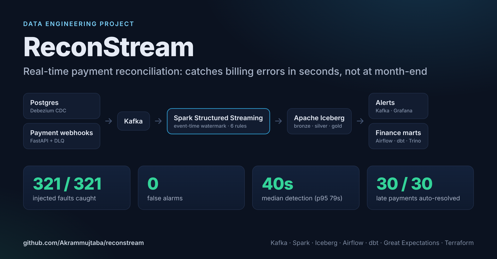
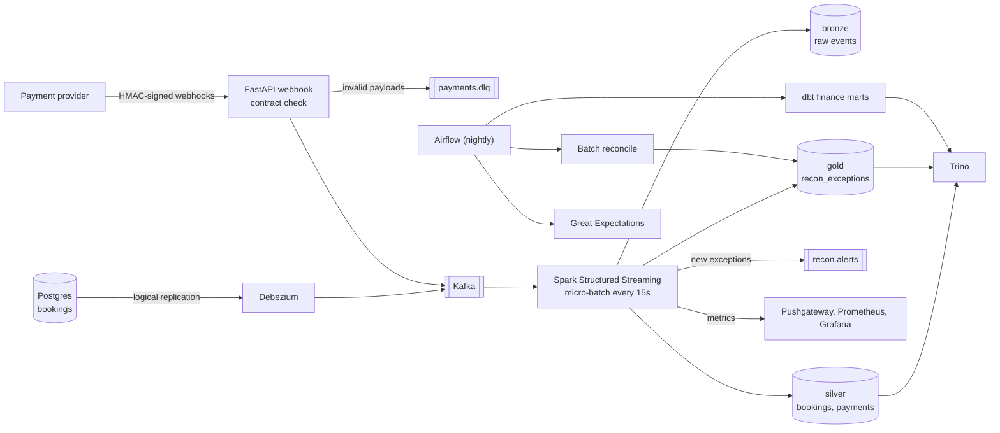
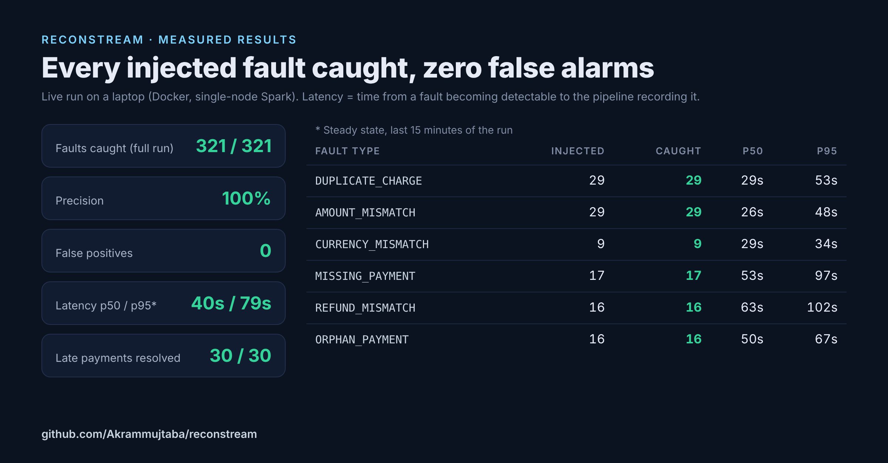

# ReconStream

**Real-time payment reconciliation for a booking marketplace.** ReconStream matches every booking against the money that actually moved, and flags double charges, missing payments, wrong amounts, and unpaid refunds within about 40 seconds (median) of when they become detectable, instead of at month-end close.




**Stack:** Postgres CDC (Debezium) · Kafka · Spark Structured Streaming · Apache Iceberg · Trino · Airflow · dbt · Great Expectations · Prometheus/Grafana · Terraform (AWS) · Docker

---

## The problem

A marketplace has two systems that are supposed to agree: the **booking database** says what a guest owes, and the **payment provider** says what was actually charged or refunded. They drift apart in ways that cost real money:

- a guest is **charged twice** after a client retry
- a booking is **confirmed but never paid**
- a cancelled booking is **refunded only partly**, or not at all
- money is captured for a **booking that doesn't exist**

Many teams only find these at month-end, when finance reconciles the books. By then the guest has already complained and the money is hard to recover.

The data makes this harder than it looks. Payment providers deliver webhooks **more than once** and **out of order** (Stripe, for example, documents both). A naive pipeline either misses real problems or raises false alarms on every redelivery.

## What it detects

| Exception | Meaning | When it fires |
|---|---|---|
| `DUPLICATE_CHARGE` | Two or more distinct captures for one booking | As soon as the second capture arrives |
| `AMOUNT_MISMATCH` | Captured amount ≠ booking total | When the capture arrives |
| `CURRENCY_MISMATCH` | Captured in a different currency | When the capture arrives |
| `MISSING_PAYMENT` | Confirmed booking, no capture | After the SLA passes (event time) |
| `REFUND_MISMATCH` | Cancelled booking not fully refunded | After the SLA passes (event time) |
| `ORPHAN_PAYMENT` | Capture for a booking that doesn't exist | After the SLA passes (event time) |

Exceptions have a lifecycle. If a late payment arrives, the matching `MISSING_PAYMENT` **resolves itself**. If the problem comes back, the exception **re-opens** and alerts again.

## Architecture



All tables are **Apache Iceberg** on S3 (SeaweedFS, an S3-compatible store, locally), with the catalog in Postgres, queryable from both Spark and Trino.

## How it works

1. **Capture.** Booking changes stream out of Postgres through Debezium (logical replication, ordered by LSN). Payment webhooks hit a FastAPI service that checks the HMAC signature and validates a strict contract. Bad payloads go to a dead-letter topic with the reason, and Kafka outages return `503` so the provider retries.
2. **Land.** Every 15 seconds Spark writes raw records to **bronze**, then MERGEs into **silver**. Bookings are upserted by key, and an older LSN never overwrites a newer one. Payments are insert-only on `event_id`, so redeliveries disappear.
3. **Reconcile.** Spark re-checks only the bookings whose answer can have changed: ones that got new events in this batch, and ones whose SLA deadline just passed. Work per batch tracks batch size, not table size. Deadlines are judged on an **event-time watermark** (newest event seen minus 30s allowed lateness), not on when Spark happened to run.
4. **Track.** Results are diffed against stored exceptions and MERGEd into **gold** as new, still-open, resolved, or re-opened. Only new and re-opened exceptions alert (Kafka topic, plus Slack if configured).
5. **Backstop.** A nightly Airflow DAG re-runs the **same rule code** over the whole day with a wall-clock "now", catching anything the stream couldn't judge. It then runs Great Expectations on silver and builds dbt marts for finance.
6. **Maintain.** Every 40 batches the stream compacts the small files and delete files its MERGEs create and expires old snapshots, so reads stay fast; a nightly DAG does a fuller pass.

The design reasoning (why `foreachBatch` instead of a stream-stream join, why event time, how idempotency works) is in [docs/design-decisions.md](docs/design-decisions.md).

## Results

The traffic generator injects known faults at known rates, plus realistic noise: duplicate deliveries, out-of-order delivery, failed payment attempts, malformed payloads, and payments that arrive after the SLA but are valid. Because every injected fault is recorded, detection can be measured rather than claimed.



Measured on a laptop (Docker Desktop, single-node Spark in local mode) after 30 minutes of generated traffic. Exact output is in the evaluator's `results.md`.

| Metric | Full run | Steady state (last 15 min) |
|---|---|---|
| Injected faults detected (recall) | **321 / 321 (100%)** | **116 / 116 (100%)** |
| Open exceptions that were real faults (precision) | **100%, 0 false positives** | **100%, 0 false positives** |
| Late-but-valid payments auto-resolved | 30 / 30 | 13 / 13 |
| Detection latency p50 | 45s | **40s** |
| Detection latency p95 | 313s* | **79s** |
| Payment events processed | 4,777 | — |

\* The full-run p95 includes the first 15 minutes, before two performance fixes and a restart catch-up (see [design decisions](docs/design-decisions.md)). The steady-state column is the current version.

Per type (steady state), p50 / p95: duplicate charge 29s / 53s, amount mismatch 26s / 48s, currency mismatch 29s / 34s, orphan payment 50s / 67s, missing payment 53s / 97s, refund mismatch 63s / 102s. Deadline-based types take longer because they wait out the 30-second allowed lateness before judging.

To reproduce: run `docker compose run --rm evaluator` after the stack has generated traffic for 20+ minutes. Set `EVAL_SINCE_MINUTES=15` to score only the most recent window.

In unit tests, a 15-minute simulated run with every fault type, pushed through the parsing and reconciliation code, finds **exactly** the injected faults: no misses, no false positives, and every late payment resolved (`tests/test_generator_end_to_end.py`).

## Run it locally

**Needs:** Docker Desktop (Windows, macOS, or Linux) with at least **12 GB of memory** assigned. On Windows, use the WSL 2 backend.

```bash
git clone https://github.com/Akrammujtaba/reconstream.git
cd reconstream
docker compose up -d --build        # first build takes ~10 minutes
docker compose ps                   # wait until services are healthy / exited 0
```

The generator starts automatically at 2 bookings per second. To change the rate: `GEN_RATE=5 docker compose up -d generator`.

| What | Where |
|---|---|
| Grafana dashboard | http://localhost:3000 (opens on the ReconStream dashboard) |
| Airflow | http://localhost:8081 (admin / admin) |
| Spark UI | http://localhost:4040 |
| Trino | http://localhost:8080 |
| Object storage browser (SeaweedFS filer) | http://localhost:8888 |
| Kafka (from host) | localhost:29092 |

**Query the lakehouse:**

```bash
docker compose exec trino trino --catalog lake
```
```sql
SELECT exception_type, status, count(*) AS n, sum(amount_at_risk_cents) / 100.0 AS at_risk
FROM gold.recon_exceptions GROUP BY 1, 2 ORDER BY 1, 2;
```

**Watch alerts as they fire:**

```bash
docker compose exec kafka /opt/kafka/bin/kafka-console-consumer.sh \
  --bootstrap-server kafka:9092 --topic recon.alerts
```

**Run the nightly pipeline now:** in Airflow, trigger `reconstream_nightly` with config `{"full": true}`. This runs batch reconciliation, Great Expectations, and dbt. After it finishes, `lake.marts.fct_daily_reconciliation` holds the finance view.

**Measure it:** `docker compose run --rm evaluator`

**Stop:** `docker compose down` (keeps data) or `docker compose down -v` (deletes everything and starts fresh next time).

## Testing

```bash
pip install -r requirements-dev.txt     # needs Java 17 for local Spark
pytest                                  # 53 tests
cd dbt && dbt seed --target ci --profiles-dir . && dbt build --target ci --profiles-dir .
```

- **Rules:** each of the six exception types, plus the cases that must *not* fire: duplicate delivery vs. real double charge, pending and deleted bookings, refunds after partial charges
- **Stream processor:** a multi-batch scenario where a missing payment is flagged on event time and then auto-resolved by a late payment; wall-clock lag that must not create false timeouts; restart recovery of the watermark
- **Generator to rules, end to end:** a simulated run's detections compared against the ground truth
- **Webhook:** signature check, every contract violation going to the DLQ, Kafka outage returning `503`
- **dbt:** 26 tests on DuckDB fixtures, including SCD2 integrity
- **CI** (GitHub Actions): lint, unit tests, dbt build, Airflow DAG import, Docker build, Terraform validate

## Repository layout

```
reconstream/          Spark code: parsing, rules, stream processor, Iceberg writes
  jobs/               spark-submit entry points: streaming, batch, quality, maintenance
services/webhook/     FastAPI payment webhook receiver
generator/            traffic simulator with fault injection and ground truth
airflow/dags/         nightly reconciliation and maintenance DAGs
dbt/                  staging, finance marts, snapshot, tests, CI fixtures
evaluation/           scores the live pipeline against injected faults
infra/                Postgres, Debezium, Spark, Airflow, Trino, Prometheus, Grafana, Terraform
tests/                53 unit and scenario tests
```

## What's next

Planned improvements are tracked in [ROADMAP.md](ROADMAP.md).

## Taking it to production

- **AWS:** `infra/terraform` provisions the S3 lake bucket, Glue catalog databases, an EMR Serverless Spark application, and least-privilege IAM. Kafka would move to MSK and Airflow to MWAA.
- **Scale:** partition `silver.payments` by `bucket(booking_id)` so the per-batch semi-joins prune files, and move compaction to a separate job so it never pauses the stream.
- **Idle watermark:** with no traffic the event-time watermark stops moving, so timeouts wait for the next event or the nightly run. A heartbeat event per partition would keep it moving.
- **Rules:** partial-refund policies, multi-currency FX tolerance, and per-merchant SLAs would come from a config table rather than code constants.

## License

MIT
